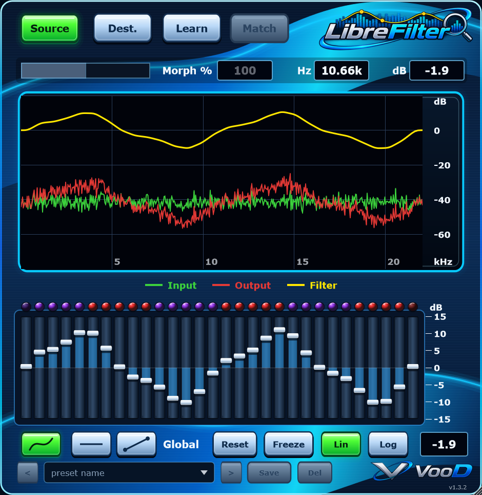

# LibreFilter 1.3 (VST3 / AU, Windows x64 + macOS Apple Silicon)

<p align="center"></p>

Reimplementación en JUCE 8 del ecualizador de filtro libre **ME FreeFilter** (Steinberg Mastering Edition,
2001). Formatos: **VST3**, **AU** y **Standalone**. Compila en **Windows x64** y **macOS arm64** (M1–M4)
con GitHub Actions.

El filtro se dedujo analizando el plugin original y está contrastado contra él (ver
[docs/ANALISIS.md](docs/ANALISIS.md), con lo verificado y lo no verificado).

## Aspecto (skin LibreFilter) y control de versiones

El nombre interno es **LibreFilter** (clases, ID del plugin `com.vood.librefilter`, archivo `LibreFilter.vst3`, carpeta de presets `Documentos/LibreFilter/Presets`, extensión `.lfcurve`); no es compatible con los presets y proyectos de la etapa «FreeFilter». La interfaz usa el pack gráfico **LibreFilter** (`resources/librefilter/`, SVG/PNG incrustados con `juce_add_binary_data`).
Solo cambia lo visual: parámetros, DSP y manejo del ratón son los mismos. La geometría está en `src/EditorLayout.h`
(espacio de diseño 940 × 980) y el dibujo de los recursos en `src/LibreSkin.cpp`. Detalles de integración: JUCE no pinta
los filtros de brillo, el patrón `grain` ni el degradado del texto de los SVG, así que `LibreSkin` preprocesa el XML al
cargarlo (halos de capas en lugar de blur) y dibuja los logos con texto de JUCE. 

Para volver al aspecto anterior (panel rojo, 454 × 417):

```bash
git switch main                    # la rama principal conserva el aspecto clásico (v1.2.1)
git checkout skin-classic-v1.2.1   # o la etiqueta exacta del último commit con el aspecto clásico
```

La rama `skin-librefilter` contiene la skin nueva; `git switch skin-librefilter` vuelve a ella.

## Qué hace

* **30 bandas** de ±15 dB, interpoladas en dB y realizadas como FIR lineal.
  * **Lin** (bandas iguales): bandas lineales hasta Nyquist, FIR de 257 taps, latencia 128 muestras.
  * **Log** (tercios de octava): 25 Hz … 20 kHz, FIR de 8193 taps por convolución particionada propia
    (`src/PartitionedConvolver.h`), latencia 4352 muestras (4096 + bloque de 256). La latencia se comunica al host.
    Al cambiar de respuesta (p. ej. dibujando sobre los sliders) se hace un fundido entre la vieja y la nueva sobre el
    mismo historial de entrada, sin chasquidos.
* **Learn / Match / Morph:** elige **Source** o **Dest.**, activa **Learn** y reproduce el material; al terminar,
  aprende el otro lado. Con ambos aprendidos, **Match** aplica `Morph · (Dest/Source)` en dB (Morph de 0 a 200 %)
  más los sliders, que en Match son un juego independiente.
* **Presets de curvas aprendidas** (abajo a la izquierda, sin diálogos del sistema): la caja de nombre es un desplegable: al pulsarla lista los presets (elige uno para cargarlo) y
  «New name...» para escribir un nombre nuevo; **Save** guarda la curva aprendida del lado seleccionado (Source o Dest.); **<** y **>** recorren los presets
  y cargan el elegido en ese mismo lado; **Del** borra el seleccionado (hay que pulsarlo dos veces). Los presets son
  archivos `.lfcurve` en `Documentos/LibreFilter/Presets/` (puedes copiarlos entre equipos). Si un preset se guardó
  a otra frecuencia de muestreo, al cargarlo el espectro se adapta por frecuencias (el aviso lo indica).
  Además, lo aprendido **persiste** al parar/arrancar la reproducción y se guarda dentro del proyecto del DAW.
* **Analizador de espectro** de entrada (verde), salida (rojo) y curva del filtro (amarillo).
* Modos de dibujo: libre, nivel y recta. Doble clic en un slider lo pone a 0 dB.
  **Reset** pone todo a 0, borra lo aprendido y desactiva Learn/Match (el doble clic en modo nivel solo pone los
  sliders a 0). **Freeze** congela el analizador, el filtro actual (los sliders y Match no lo cambian) y el aprendizaje;
  el audio sigue pasando por el filtro congelado.
* Las **bolitas** sobre los sliders marcan la banda que se está tocando (o el rango tocado al dibujar en modo libre),
  como en el original; alternan morado/rojo cada 5 bandas.
* Clic en el logo del plugin → tema rojo (easter egg: panel rojizo como el plugin original de Steinberg; se guarda en el
  proyecto). Clic en el logo VooD → créditos.

## Comprobaciones

* `tests/dsp_test.cpp`: núcleo DSP (sin JUCE), con valores medidos en el plugin original.
* Contraste con la DLL original (con licencia propia, host de 32 bits que procesa el mismo ruido): en modo Lin y en
  Match la salida coincide en todo el rango útil a ±0,0005 dB; solo se separa en los últimos ~2 kHz antes de Nyquist
  (hasta 0,13 dB con sliders extremos). Detalles en [docs/ANALISIS.md](docs/ANALISIS.md).
* Regresión entre versiones: Lin y Match son idénticos bit a bit a v1.2.1; Log solo cambia el retardo (+256 muestras).

## Compilar

Requisitos: CMake ≥ 3.22 y un compilador C++17 (MSVC o Xcode). JUCE se descarga solo.

```bash
cmake -S . -B build -DCMAKE_BUILD_TYPE=Release
cmake --build build --config Release --parallel
```

Los binarios quedan en `build/LibreFilter_artefacts/Release/`.
Tests del DSP (sin JUCE): `g++ -std=c++17 tests/dsp_test.cpp -o dsp_test && ./dsp_test`.

## GitHub Actions

`.github/workflows/build.yml` ejecuta los tests y compila Windows x64 y macOS arm64 en cada *push*.
Los `.zip` salen como artefactos. Una etiqueta `v*` crea además un *release* en borrador.

## Instalar en macOS

Los binarios llevan firma *ad-hoc* (sin cuenta de desarrollador), así que Gatekeeper los pone en cuarentena
al descargarlos:

```bash
xattr -cr "LibreFilter.vst3"
cp -R "LibreFilter.vst3" ~/Library/Audio/Plug-Ins/VST3/
```

(AU: `~/Library/Audio/Plug-Ins/Components/`).

## Aviso legal

El plugin original es software comercial de terceros (© Spectral Design GmbH / Steinberg). Este repositorio
contiene **código propio**: ni la DLL original, ni código decompilado, ni sus mapas de bits se incluyen.
Las ideas y algoritmos (interpolación, ventana Hann, FIR, espectros medios) no son material con copyright.
